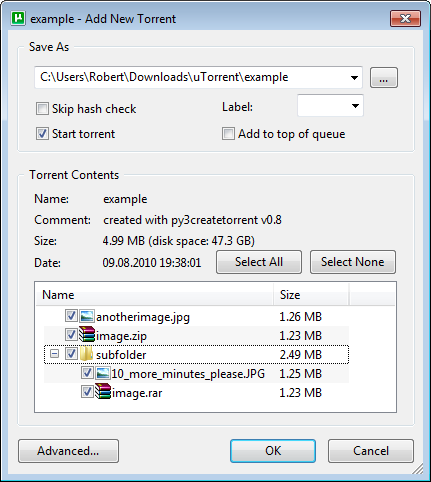
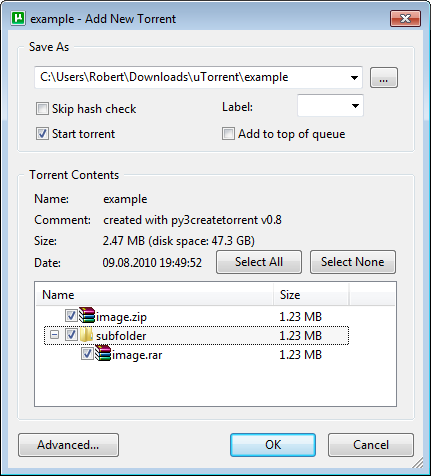

py3createtorrent
================

*Create torrents via command line!*

py3createtorrent is a comprehensive shell/commandline utility for creating torrents (Linux & Windows).

Features
--------

Some of the features:

- supports **BitTorrent v1, v2, and hybrid** torrents (BEP 52)
- create torrents with **multiple trackers** or **trackerless torrents**
- **automatically choose the most reliable trackers** from `ngosang/trackerslist <https://github.com/ngosang/trackerslist>`_
- add **webseeds** to torrents
- create **private torrents** (disabled DHT, ...)
- **exclude specific files/folders**
- exclude files/folders based on **regular expressions**
- specify **custom piece sizes**
- specify custom creation dates

Requirements
------------

py3createtorrent requires at least Python 3.11 and the `bencode.py <https://pypi.org/project/bencode.py/>`_ module.

Installation
------------

Recommended: Installation using pip
^^^^^^^^^^^^^^^^^^^^^^^^^^^^^^^^^^^

pip is the easiest and recommended way of installing py3createtorrent.

Just execute::

  pip3 install py3createtorrent

After that, you can use py3createtorrent on your commandline.

Alternative: Manual installation
^^^^^^^^^^^^^^^^^^^^^^^^^^^^^^^^

Alternatively, you can download py3createtorrent manually. Download the desired version from here:
https://github.com/rsnitsch/py3createtorrent/releases

And then install the dependencies::

  pip install bencode.py

Then you can execute py3createtorrent.py (it is in the ``src`` folder).

Basic usage
-----------

Creating a torrent is as simple as::

    py3createtorrent -t udp://tracker.opentrackr.org:1337/announce file_or_folder

The shortcut ``bestN`` can be used for conveniently adding the best N trackers
from `ngosang/trackerslist <https://github.com/ngosang/trackerslist>`_. Example::

    py3createtorrent -t best3 file_or_folder

Multiple trackers can also be specified manually by using ``-t`` multiple times, for example::

    py3createtorrent -t udp://tracker.opentrackr.org:1337/announce -t udp://tracker.cyberia.is:6969/announce file_or_folder

Full usage guide
----------------

Syntax:

.. code-block:: none

    usage: py3createtorrent.py <target> [-t tracker_url] [options ...]
    
    py3createtorrent is a command line utility for creating torrents (v1, v2, hybrid).
    
    positional arguments:
      target                File or folder for which to create a torrent
    
    options:
      -h, --help            show this help message and exit
      -t, --tracker TRACKER_URL
                            Add one or multiple tracker (announce) URLs (supports 'bestN').
      --best-trackers-url URL
                            URL used to fetch trackers when using 'bestN'. [default:
                            https://raw.githubusercontent.com/ngosang/trackerslist/master/trackers_best.txt]
      --node HOST,PORT      Add one or multiple DHT bootstrap nodes.
      --webseed WEBSEED_URL
                            Add one or multiple HTTP/FTP URLs as seeds (GetRight-style).
      -p, --piece-length PIECE_LENGTH
                            Set piece size in KiB (must be a power of two). [default: 0 = automatic]
      -P, --private         Set the private flag to disable DHT and PEX.
      --protocol {v1,v2,hybrid}
                            BitTorrent protocol version to generate. [default: hybrid]
      -o, --output PATH     Set the filename and/or output directory of the created file. [default: <name>.torrent]
      -e, --exclude PATH    Exclude a specific path (can be repeated to exclude multiple paths).
      --exclude-pattern REGEXP
                            Exclude paths matching a regular expression (can be repeated to use multiple patterns).
      --exclude-pattern-ci REGEXP
                            Same as --exclude-pattern but case-insensitive.
      -n, --name NAME       Set the name of the torrent. [default: <basename of target>]
      -c, --comment COMMENT
                            Add a comment.
      -s, --source SOURCE   Add a source tag.
      -d, --date TIMESTAMP  Overwrite creation date. Expects a unix timestamp. Specify -2 to disable creation date completely. [default: -1 = current date and
                            time]
      --no-created-by       Omit the 'created by' field from the torrent metainfo.
      -v, --verbose         Enable debug logging output.
      --version             show program's version number and exit

Protocol version (``--protocol``)
^^^^^^^^^^^^^^^^^^^^^^^^^^^^^^^^^

Selects which BitTorrent protocol metadata is written to the ``.torrent`` file:

- ``hybrid`` *(default)*: Generates a BEP 52 hybrid torrent compatible with both BitTorrent v1 and v2 clients.
- ``v1``: Generates a classic BitTorrent v1 torrent (SHA-1 piece hashes only).
- ``v2``: Generates a pure BitTorrent v2 torrent (BEP 52 SHA-256 Merkle trees only).

Example::

    py3createtorrent --protocol v2 my_data_folder/

Specifying trackers (``-t``, ``--tracker``)
^^^^^^^^^^^^^^^^^^^^^^^^^^^^^^^^^^^^^^^^^^^

One or multiple tracker URLs can be specified using the ``-t`` or ``--tracker`` switch. Single tracker example::

    py3createtorrent -t udp://tracker.opentrackr.org:1337/announce my_data_folder/

For multiple trackers, just use ``-t`` repeatedly. Multiple tracker example::

    py3createtorrent -t udp://tracker.opentrackr.org:1337/announce -t udp://tracker.cyberia.is:6969/announce my_data_folder/

.. _bestN_shortcut:

bestN: Automatically add the best trackers
""""""""""""""""""""""""""""""""""""""""""

You can use ``bestN`` to add the best N trackers from https://github.com/ngosang/trackerslist. This requires internet access, obviously.

For example::

    py3createtorrent -t best5 my_data_folder/

See :ref:`best_trackers_url` if you want to fetch the tracker list from a different URL.

Trackerless torrents
""""""""""""""""""""

You can create a trackerless torrent by not specifying any tracker URLs at all (i.e. don't
use the ``-t`` switch at all).

.. _best_trackers_url:

Best trackers URL (``--best-trackers-url``)
^^^^^^^^^^^^^^^^^^^^^^^^^^^^^^^^^^^^^^^^^^^

Overrides the URL from which tracker URLs are downloaded when using the :ref:`bestN shortcut <bestN_shortcut>`.
The expected format is a plain text file containing one tracker announce URL per line (empty lines are ignored).

The default URL is::

    https://raw.githubusercontent.com/ngosang/trackerslist/master/trackers_best.txt

Example::

    py3createtorrent -t best5 --best-trackers-url https://ngosang.github.io/trackerslist/trackers_best_ip.txt my_data_folder/

Specifying DHT bootstrap nodes (``--node``)
^^^^^^^^^^^^^^^^^^^^^^^^^^^^^^^^^^^^^^^^^^^

One or multiple DHT bootstrap nodes can be specified using the ``--node`` switch. Each bootstrap node must be
specified in the form ``host,port``. Just like ``-t``, the ``--node`` switch can be used repeatedly in order
to specify multiple DHT bootstrap nodes.

Example::

    py3createtorrent --node router.bittorrent.com,8991 --node second.node.com,1337 my_data_folder/

It is recommended to specify some DHT bootstrap nodes for trackerless torrents.

Webseeds (``--webseed``)
^^^^^^^^^^^^^^^^^^^^^^^^

One or multiple HTTP/FTP URLs can be added as GetRight-style webseeds (stored in the ``url-list`` field)::

    py3createtorrent --webseed https://example.com/files/ my_data_folder/

Piece size (``-p``)
^^^^^^^^^^^^^^^^^^^

This switch allows you to specify a custom piece size in KiB (must be a power of two and at least 16 KiB). The piece size should be
chosen with care, because it affects the following properties:

- size of the .torrent file
- network overhead
- cost of fixing corrupted pieces
- time it takes until peers start sharing data

.. note::

   Unless you know what you're doing, please let py3createtorrent automatically
   determine the best piece size for you.

Background
""""""""""

In general, the files for which a .torrent is created are sliced up in **pieces**.

For each piece, a checksum (20-byte SHA-1 for v1, 32-byte SHA-256 Merkle tree hashes for v2) is
calculated and stored inside the .torrent file - this, by the way, is the
time-consuming part of torrent creation. Therefore, the piece size strongly
correlates with the size of the created .torrent file: The larger the pieces,
the smaller the number of pieces for which a checksum must be stored (and vice
versa).

The piece size also affects the **network overhead** involved in the peer-2-peer
communication for a torrent. The peers regularly exchange information records
that specify the pieces that each peer has finished downloading so that they know
where they can get certain pieces from. The greater the number of pieces, the
larger these information records need to be and thus the greater the overhead
will tend to be.

Moreover, corrupted pieces need to be redownloaded. Of course, large pieces
are more expensive to redownload (both in terms of time and traffic).

Finally, the piece size also affects the time it takes until peers
start to share data with each other (only pieces that have been downloaded
completely can be shared with other peers). Therefore, if the piece size is
large, it will take longer for any peer to finish downloading a piece and to be
able to share this piece with other peers.

Private torrents (``-P``)
^^^^^^^^^^^^^^^^^^^^^^^^^

Private torrents force the BitTorrent clients to only use the specified trackers
for discovering other peers. Advanced peer discovery methods like DHT or
peer list exchange are effectively disabled.

Comment (``-c``)
^^^^^^^^^^^^^^^^

The comment is a short text stored in the .torrent file and displayed by most
BitTorrent clients in the torrent info. If omitted, no ``comment`` field is added.

Created-by metadata (``--no-created-by``)
^^^^^^^^^^^^^^^^^^^^^^^^^^^^^^^^^^^^^^^^^

By default, py3createtorrent sets the ``created by`` metainfo field to ``py3createtorrent v<version>``.
Use ``--no-created-by`` to omit this field completely.

Source (``-s``)
^^^^^^^^^^^^^^^

The source field is a non-standard metainfo field used by private trackers to
reduce issues (such as misreported stats) caused by cross-seeding.  For
private trackers that forbid their torrent files from being uploaded elsewhere,
it ensures that torrent files uploaded to the tracker from a different source
are unique to the private tracker.

Verbose (``-v``)
^^^^^^^^^^^^^^^^

Verbose mode makes py3createtorrent report about the individual steps it is
undertaking while creating the .torrent file.

This is particularly useful for debugging purposes.

Output path (``-o``)
^^^^^^^^^^^^^^^^^^^^

The output path is either the directory in which the .torrent file should be
saved or the complete path to the destination .torrent file. In the former
case, the name of the .torrent file is deduced from the input's name (i.e.
the input directory's or file's name), unless this name is explicitly
overwritten (using the ``-n`` switch). (In the latter case, the name of the
.torrent file is itself specified by the output path.)

By default, py3createtorrent uses the current working directory as the output
directory.

Exclude path (``-e``)
^^^^^^^^^^^^^^^^^^^^^

This allows for the exclusion of specific files or directories.

The switch may be used repeatedly to exclude multiple files/directories.

On Windows, this is case-insensitive.

Exclude pattern (``--exclude-pattern``, ``--exclude-pattern-ci``)
^^^^^^^^^^^^^^^^^^^^^^^^^^^^^^^^^^^^^^^^^^^^^^^^^^^^^^^^^^^^^^^^^

This allows for the exclusion of files or directories that match a certain
regular expression. Patterns are matched against paths relative to the target root
using forward slashes (``/``).

The switches may be used repeatedly to specify multiple exclusion patterns.
Use ``--exclude-pattern-ci`` for case-insensitive matching.

Creation date (``-d``)
^^^^^^^^^^^^^^^^^^^^^^

This switch allows you to overwrite the creation date saved in the .torrent
file. You can fake any creation date you like.

The creation date is specified as `UNIX timestamp
<https://en.wikipedia.org/wiki/Unix_time>`_.

You can disable storing a creation date altogether by providing a timestamp
of -2.

Name (``-n``)
^^^^^^^^^^^^^

This setting overwrites the file or directory name stored inside the .torrent
file. **Thus it affects the file or directory name that will be presented
to downloaders as the real name of the data.** You can use it to avoid
renaming your input data.

Unless a destination .torrent file is explicitly specified (using the ``-o`` switch),
this name will also be used to deduce the name of the resulting .torrent file.

.. note::

   The name switch is an advanced feature that most users probably don't need.
   Therefore, please refrain from using this feature, unless you really know
   what you're doing.

   For most intents and purposes, the ``-o`` switch is probably more suitable.

Examples
--------

Assume there is a folder "example" with the following contents::

   example/
     subfolder/
       10_more_minutes_please.JPG
       image.rar
     anotherimage.jpg
     image.zip

Assume, we're currently inside the parent directory.

Example 1 - from directory, no options, default behaviour
^^^^^^^^^^^^^^^^^^^^^^^^^^^^^^^^^^^^^^^^^^^^^^^^^^^^^^^^^

**Command**::

   py3createtorrent example -t udp://tracker.opentrackr.org:1337/announce

**Effect**:
Creates ``example.torrent`` inside the current directory.

In µTorrent it will look like this:

Example 2 - from directory, excluding subfolders
^^^^^^^^^^^^^^^^^^^^^^^^^^^^^^^^^^^^^^^^^^^^^^^^

**Command**::

   py3createtorrent -e example\subfolder example -t udp://tracker.opentrackr.org:1337/announce

**Effect**:
Creates ``example.torrent`` inside the current directory. ``example\subfolder`` has
been excluded.

.. tip::
   Of course you can exclude multiple subfolders, e.g.::

      py3createtorrent -e exclusion1 -e exclusion2 yourfolder -t tracker-url

In µTorrent it will look like this:

Example 3 - from directory, excluding files
^^^^^^^^^^^^^^^^^^^^^^^^^^^^^^^^^^^^^^^^^^^

**Command**::

   py3createtorrent -e example\anotherimage.jpg -e example\subfolder\10_more_minutes_please.JPG example -t udp://tracker.opentrackr.org:1337/announce

Alternative, equivalent command using **regular expressions** instead of
specifying each jpg separately::

   py3createtorrent --exclude-pattern "\.(jpg|JPG)$" example -t udp://tracker.opentrackr.org:1337/announce

With ``--exclude-pattern-ci`` the pattern-matching will be case-insensitive, so we can use a simplified regular expression::

  py3createtorrent --exclude-pattern-ci "\.jpg$" example -t udp://tracker.opentrackr.org:1337/announce

**Effect**:
Creates ``example.torrent`` inside the current directory. ``example\anotherimage.jpg``
and ``example\subfolder\10_more_minutes_please.JPG`` have been excluded.

In µTorrent it will look like this:

Creating torrents of single files
^^^^^^^^^^^^^^^^^^^^^^^^^^^^^^^^^

It's almost the same as for creating directories, except, of course, you can't
use the exclude-option anymore.
